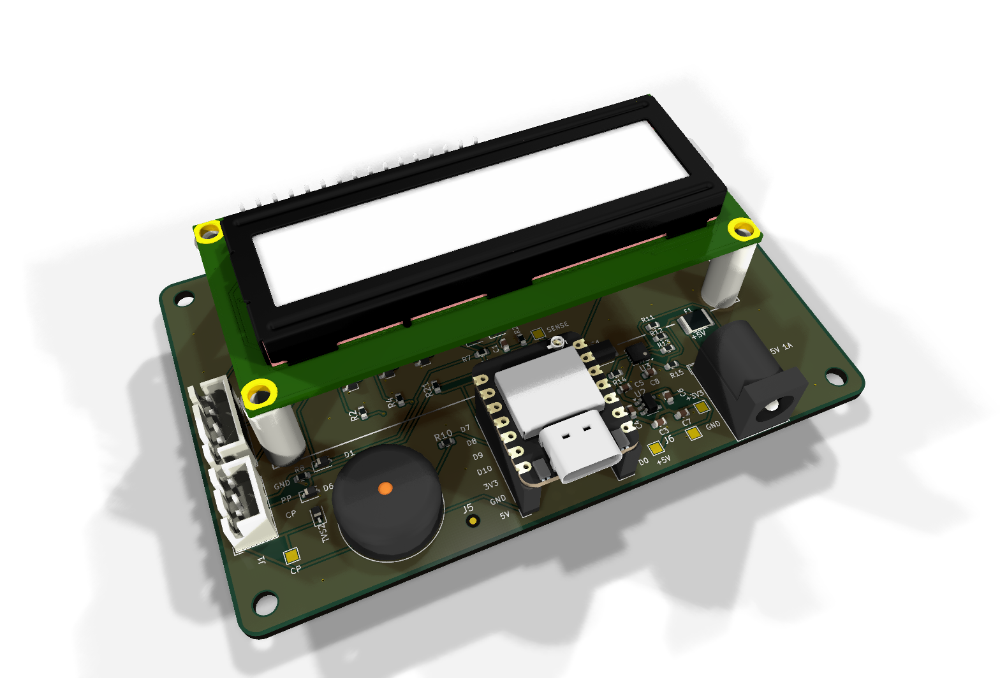
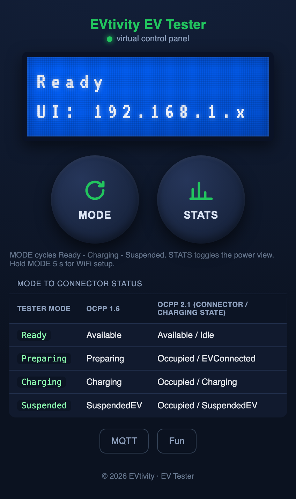
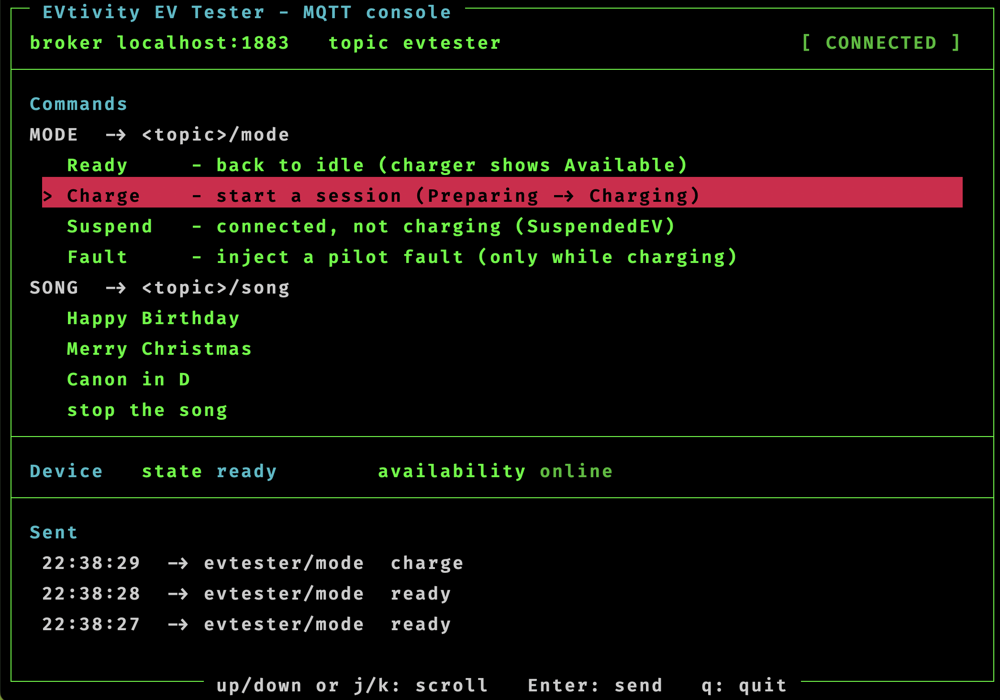
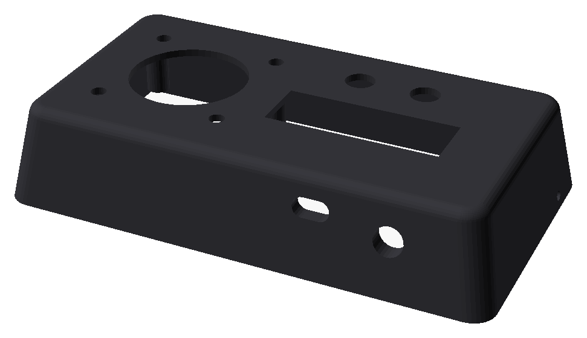
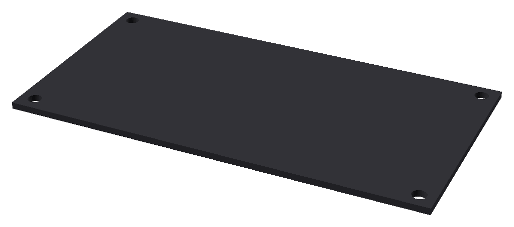
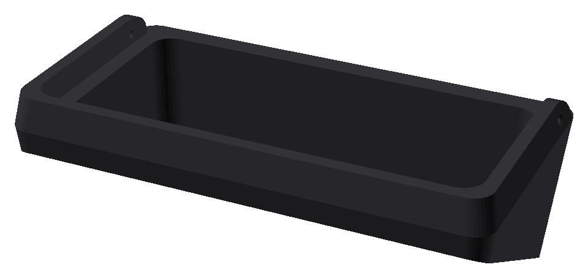

# EVtivity EV Tester (AC / J1772)

An open-source, EV-side charging simulator. It emulates an electric vehicle so you can
test AC charging stations (EVSE) and CSMS backends on the bench, without a real car.

<p align="center">
  
</p>

Built around a Seeed XIAO ESP32-S3 on a small carrier PCB, it drives the SAE J1772 /
IEC 61851-1 Control Pilot line through states A, B, and C, reads the charger's offered
current from the CP PWM, and reports proximity. A charger sees a full session lifecycle:
vehicle detect, transaction start, Charging status, offered current, transaction stop.

**Demos:** the tester running in its [3D-printed enclosure](https://www.youtube.com/shorts/O5QMILcCc_8),
with more on the [EVtivity YouTube channel](https://www.youtube.com/@evtivity).

## What it does

- Emulates the EV side of a **Type 1 / SAE J1772** AC session.
- Cycles three deliberate modes with the MODE button: **Ready** (State A), **Charging**
  (handshake in State B, then State C), **Suspended** (back to State B while plugged).
- Reads the **offered current** from the Control Pilot PWM and shows it on the LCD.
- Injects a **pilot fault** on demand to exercise the charger's fault handling.
- 16x2 I2C **LCD**, a built-in **web UI** (mirrors the LCD, remote control), and optional
  **MQTT** remote control.

## What it does not do

This is a **low-voltage signaling** tester. It does **not** draw current or measure energy.
When you enter Charging the EVSE closes its contactor and opens a session, but because no
real load is connected the charger's meter reads near zero. That is expected and by design.
The LCD "offered" and "kW" values are computed from the pilot duty (what the charger
advertises), not measured from current flow.

## Web UI and MQTT control

Once on WiFi, the device serves a login-protected **web control panel** that mirrors the LCD
and drives the session from a browser - the same MODE/STATS controls, the mode-to-OCPP status
mapping, and a live MQTT panel. Hold **MODE** for 5 s (physical or on-screen) to open the
WiFi/MQTT setup access point.

<p align="center">
  
</p>

For automation, the tester also connects to an **MQTT broker**, taking `mode` and `song`
commands while publishing its live `state` (retained) and `availability` (last-will). The repo
ships a terminal console client, **`mqtt-test.py`** - run it, point it at your broker and topic,
and scroll the commands with the arrow keys. See `USER-MANUAL.html` for the full command
reference and how to run a local broker.

<p align="center">
  
</p>

## 3D-printed enclosure

An optional printed case houses the board, LCD, and J1772 inlet. It prints in three parts and
fastens together with M3 screws. STL files are in [`enclosure/`](enclosure/), and there is a
[build demo video](https://www.youtube.com/shorts/O5QMILcCc_8).

<table>
  <tr>
    <td align="center" width="33%"></td>
    <td align="center" width="33%"></td>
    <td align="center" width="33%"></td>
  </tr>
  <tr>
    <td align="center"><b>Top</b><br>front cover: inlet, LCD, and button cutouts</td>
    <td align="center"><b>Bottom</b><br>base plate</td>
    <td align="center"><b>Mount</b><br>mounting bracket</td>
  </tr>
</table>

## Repository layout

| Path | What it is |
|---|---|
| `firmware/ac_tester/` | The Arduino firmware for the XIAO ESP32-S3 (flash this). |
| `jlcpcb/` | The KiCad design plus ready-to-order Gerbers, BOM, and pick-and-place files. |
| `docs/HARDWARE.md` | Build guide: parts list, connector pinout, and how to wire a J1772 inlet. |
| `enclosure/` | 3D-printable case (STL files). |
| `USER-MANUAL.html` | Full user manual (modes, buttons, LCD, web UI, MQTT). |
| `mqtt-test.py` | Terminal MQTT console client for driving the tester over a broker. |
| `AC-tester-BOM-amazon.html` | Buy-links list for the parts you add yourself (the ones JLCPCB does not assemble). |

## Order the board

The `jlcpcb/` folder has everything to order the board fully assembled from
[JLCPCB](https://jlcpcb.com):

1. Upload `jlcpcb/ac-tester-gerbers.zip` to fabricate the bare PCB.
2. For assembly, upload `jlcpcb/ac-tester-bom.csv` (BOM) and `jlcpcb/ac-tester-cpl.csv`
   (component placement).

JLCPCB assembles the SMD parts on the board. The modules and hardware you add yourself - the
Seeed XIAO ESP32-S3, the 16x2 I2C LCD, the U.FL antenna, the J1772 inlet, and the case hardware
- are listed with buy links in [`AC-tester-BOM-amazon.html`](AC-tester-BOM-amazon.html).

To open or modify the design, use [KiCad](https://www.kicad.org) and
`jlcpcb/ac-tester-production.kicad_pro`. `jlcpcb/ac-tester-schematic.pdf` and
`jlcpcb/ac-tester-3d-full.step` are provided for reference and mechanical fit.

## Assemble and wire it to a charger

The board is only the carrier. You also add a **Seeed XIAO ESP32-S3**, a **16x2 I2C LCD**, a
**U.FL antenna**, and a **J1772 inlet** (the vehicle-side socket the charger plugs into).

The one connection people ask about: this tester emulates the **vehicle**, so a charger's
connector plugs into a J1772 inlet, and you wire that inlet's three signal lines to connector
**J1** on the board:

| J1772 inlet | Board J1 |
|---|---|
| Control Pilot (CP) | CP |
| Proximity (PP) | PP |
| Protective Earth / Ground | GND |

The inlet's AC power pins are left unconnected. Full parts list, pinout, and step-by-step
assembly are in **[`docs/HARDWARE.md`](docs/HARDWARE.md)**.

## Build and flash the firmware

Target: **Seeed XIAO ESP32-S3**, Arduino-ESP32 core 3.x.

Using [arduino-cli](https://arduino.github.io/arduino-cli/):

```sh
arduino-cli core install esp32:esp32
arduino-cli compile --fqbn esp32:esp32:XIAO_ESP32S3 firmware/ac_tester
arduino-cli upload  --fqbn esp32:esp32:XIAO_ESP32S3 -p <your-port> firmware/ac_tester
```

Or open `firmware/ac_tester/ac_tester.ino` in the Arduino IDE, select the XIAO ESP32-S3
board, and upload.

> **The WiFi antenna is required.** The XIAO ESP32-S3 has **no onboard antenna**. Clip on
> the external U.FL/IPEX antenna or WiFi will not work. WiFi is optional, though: with no
> credentials the device runs fully as a tester and you can hold **MODE** for 5 s to open a
> setup access point and configure WiFi/MQTT from your phone.

> **Weak WiFi / `AUTH_EXPIRE` on early XIAO ESP32-S3 boards.** XIAO ESP32-S3 units made before
> August 2025 have a marginal RF front end: at full TX power the signal is distorted and the
> access point drops the connection with `Reason 2 (AUTH_EXPIRE)`, even with the antenna on and
> the router nearby. The firmware already works around this by capping the WiFi TX power to 15 dBm
> (`esp_wifi_set_max_tx_power`), which restores a strong, reliable connection. Leave that in place;
> it is harmless on newer boards. This is a known Seeed issue - see
> [Seeed's XIAO ESP32-S3 WiFi notes](https://wiki.seeedstudio.com/xiao_esp32s3_wifi_usage/).

> **If the boot splash and jingle ever play twice.** This is an interrupt-watchdog reset
> (`TG1WDT_SYS_RST`) during WiFi start-up, and it comes from the Arduino ESP32 core rather than
> this sketch. The core ships its prebuilt WiFi libraries with `CONFIG_ESP_WIFI_IRAM_OPT` and
> `CONFIG_ESP_WIFI_RX_IRAM_OPT` turned **off** (ESP-IDF turns both on by default) to save about
> 5 KB of IRAM, which leaves the WiFi driver's interrupt path running from flash. Any flash write
> disables the instruction cache while it runs, and if the WiFi hardware raises an interrupt in that
> window the handler faults and the watchdog resets the board. In short, **on this platform a flash
> write while WiFi is running can reset the board.** It is not the power supply, and it is not the
> display. The firmware handles it two ways: it shuts the radio down before every settings write,
> and it brings the WiFi PHY up in the first 20 ms of boot so the one write it cannot move (the
> radio's own calibration data, stored once after a first flash or a core upgrade) happens before
> the screen and the fanfare. **If you add code to this firmware, never write to flash while WiFi is
> up** - use the same pattern as `stopWifiForFlash()`. A complete fix requires building with
> ESP-IDF and `CONFIG_ESP_WIFI_IRAM_OPT=y`, which is not settable from the Arduino IDE or
> `arduino-cli`.

See `USER-MANUAL.html` for the modes, buttons, web UI, and MQTT command reference.

## Safety and scope

This tester keeps everything at the low-voltage EV-signaling side of J1772, so it is safe
to build and use on the bench. It is **not** a DC fast-charge tester and does not handle
mains or high-voltage DC.

## License

Dual-licensed by component: firmware under **Apache-2.0**, hardware under **CERN-OHL-P-2.0**.
See [`LICENSE`](LICENSE) for details. You are free to build, modify, and sell the hardware
and firmware; the EVtivity name and logo are not covered by these licenses.

## Contributing

Issues and pull requests are welcome. See [`CONTRIBUTING.md`](CONTRIBUTING.md).
